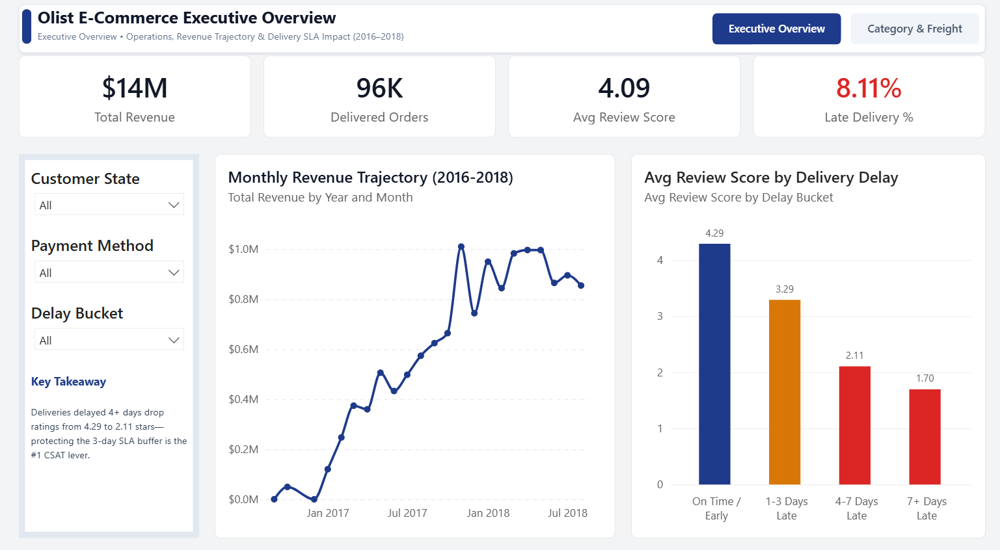
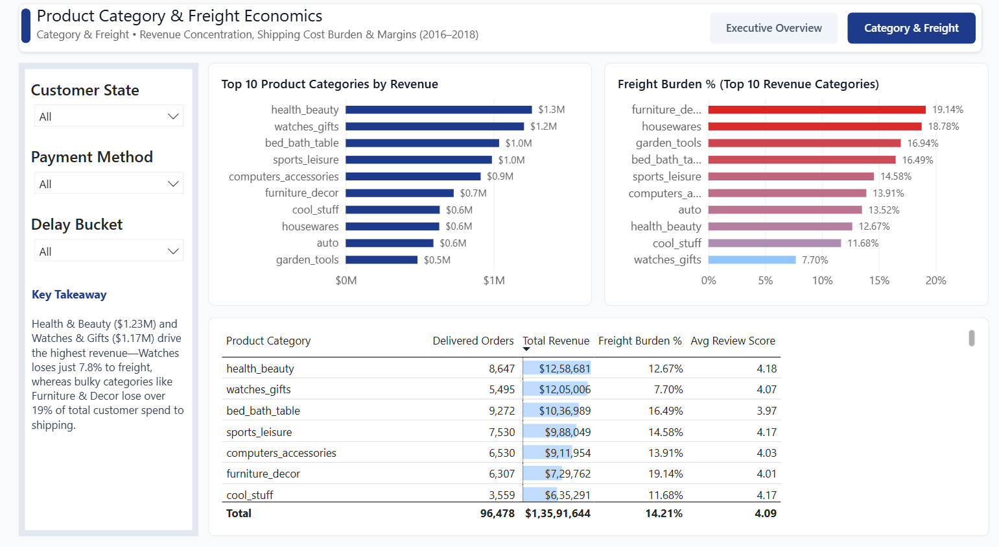

# Olist E-Commerce Executive Analytics Dashboard (Power BI)

An interactive, two-page executive Power BI report analyzing **96,478 delivered orders** and **\$13.59M in gross revenue** across the Brazilian Olist E-Commerce marketplace (2016–2018). Built on a star-schema data model to evaluate revenue growth, delivery SLA impact on customer satisfaction, and product category freight economics.

---

## Dashboard Preview

### 1. Executive Overview

* **Top-Line KPIs:** Tracks Total Revenue (`$13.59M`), Delivered Orders (`96,478`), Average Review Score (`4.09 / 5.0`), and Late Delivery Rate (`8.11%`).
* **Revenue Trajectory:** Visualizes monthly order revenue expansion from late 2016 through August 2018 (filtering out incomplete September/October 2018 tail records).
* **Delivery SLA Impact:** Demonstrates that on-time/early deliveries average **4.29 stars**, while delays exceeding 4 days drop satisfaction below **2.11 stars**.

### 2. Product Category & Freight Economics

* **Revenue Concentration:** Ranks the top 10 revenue-generating categories led by **Health & Beauty (\$1.26M)** and **Watches & Gifts (\$1.21M)**.
* **Freight Burden Analysis:** Compares shipping cost as a percentage of total customer spend across top categories—highlighting bulky categories like **Furniture & Decor (19.14% freight burden)** vs. high-margin categories like **Watches & Gifts (7.70%)**.
* **Category Performance Matrix:** Full cross-filtered breakdown of delivered orders, revenue, freight burden, and review scores across all categories.

---

## Data Modeling & DAX Highlights

* **Star Schema Architecture:** Fact table (`item_masters`) connected to master order dimension (`order_masters`) via `order_id`, paired with a dedicated `_Measures` table.
* **Bidirectional Cross-Filtering in DAX:** Applied `CROSSFILTER` inside `Delivered Orders` and `Avg Review Score` measures so product-level attributes accurately aggregate order-level metrics without introducing bidirectional relationship ambiguity.
* **Period Filtering:** Implemented an `Is Valid Period` calculated flag (`< 2018-09-01`) to eliminate artificial end-of-dataset truncation cliffs.

---

## Repository Structure

```text
olist-executive-powerbi-dashboard/
├── assets/
│   ├── page1_executive_overview.png
│   └── page2_category_freight.png
├── olist_executive_report.pbix
└── README.md